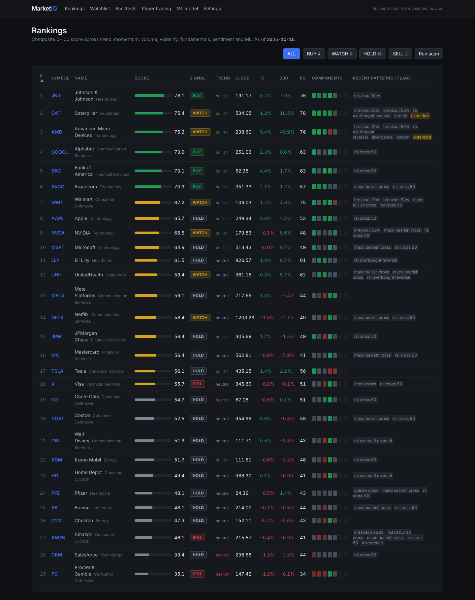

# MarketIQ

Explainable stock research platform: scans a 20–30 stock universe, computes technical indicators,
detects patterns, scores fundamentals and news, ranks opportunities 0–100 with a full explanation,
emits BUY / SELL / HOLD / WATCH signals from documented rules, and lets you backtest, walk-forward
validate and paper trade the strategy. Built on infrastructure from
[FinRL-X](https://github.com/AI4Finance-Foundation/FinRL-Trading) (Apache 2.0, see `NOTICE`).

Research tool only. Not investment advice. Real-money trading is disabled by default.



## What's inside

- **Data**: SQLite (Postgres via `DATABASE_URL`), NYSE trading calendar with gap-only fetching,
  providers for yfinance (free) and Financial Modeling Prep, and an importer for the real dataset
  bundled with FinRL-X: daily OHLCV 2015–2025 for 506 tickers and ~19k quarters of statements.
- **Analysis**: RSI, MACD, SMA 20/50/200, EMA, ATR, Bollinger, OBV, volume ratio, 52-week range;
  trend regime, golden/death cross, breakouts/breakdowns with volume confirmation, MACD/RSI crosses,
  oversold/overbought reversals, RSI divergence, mean-reversion stretch.
- **Fundamentals** (point-in-time): TTM growth, margins, ROE, leverage, liquidity, FCF, valuation,
  ranked as universe percentiles.
- **Sentiment**: offline finance lexicon by default, OpenAI optional, recency-weighted aggregation.
- **Scoring**: configurable component weights in `config/scoring.yaml`; every score carries factor
  values, factor scores and plain-English reasons (`docs/SCORING.md`).
- **Signals**: ordered rules in `config/signals.yaml` with risk flags (`docs/SIGNALS.md`).
- **ML**: LightGBM direction model over a configurable horizon with walk-forward validation and a
  validation gate; a model that shows no out-of-sample skill does not touch the score.
- **Backtesting**: event-driven, next-open fills, costs, benchmark comparison; walk-forward harness.
- **Paper trading**: simulated broker persisted in the DB; optional Alpaca paper adapter.
- **API + dashboard**: FastAPI (`/docs` for OpenAPI) and a Next.js 14 dashboard with interactive
  candlestick charts, indicator panels, score breakdowns, signal explanations, watchlist, backtests,
  paper trading, ML diagnostics and a weights editor.

## Quick start

Requirements: Python 3.11+, Node 18+.

```bash
git clone <this repo> marketiq && cd marketiq
python -m venv .venv && source .venv/bin/activate
pip install -e ".[dev,ml]"
cp .env.example .env            # optional: add FMP / OpenAI / Alpaca keys

# 1. Unpack the bundled real dataset (423 MB SQLite inside data/finrl_trading.7z)
python -c "import py7zr; py7zr.SevenZipFile('data/finrl_trading.7z').extractall('data/')"   # pip install py7zr
#    or: 7z x data/finrl_trading.7z -odata/

# 2. Create the database and import the universe (config/universe.yaml)
marketiq init-db
marketiq import-finrlx

# 3. Scan, train, backtest
marketiq scan --explain NVDA
marketiq train
marketiq backtest --start 2021-01-04 --end 2025-10-15
marketiq walk-forward --start 2022-01-03 --end 2025-10-15
marketiq paper create && marketiq paper rebalance

# 4. Run the API and dashboard
marketiq serve                   # http://127.0.0.1:8000/docs
cd web && npm install && npm run dev   # http://localhost:3000
```

Platform notes:
- macOS without Homebrew: the LightGBM wheel cannot load (`libomp` missing). MarketIQ falls back to
  scikit-learn's gradient boosting automatically; `brew install libomp` enables LightGBM.
- If your shell exports `NODE_ENV=production`, `npm install` skips dev dependencies and the frontend
  build fails. Use `NODE_ENV=development npm ci --include=dev` in `web/`.

With internet access, extend the dataset forward and add news/earnings dates:

```bash
marketiq fetch --prices                  # fills missing trading days from yfinance (or --provider fmp)
marketiq fetch --fundamentals --news     # quarterly statements, earnings dates, recent news + sentiment
```

Docker: `docker compose up --build` starts the API on 8000 and the dashboard on 3000 (mount `data/`).

## CLI

| Command | What it does |
|---|---|
| `marketiq init-db` | create tables, register universe tickers |
| `marketiq import-finrlx` | load prices + statements from the bundled FinRL-X DB (drops the partial last day) |
| `marketiq fetch [--prices] [--fundamentals] [--news]` | fill gaps from the live provider |
| `marketiq coverage` | stored price coverage per symbol |
| `marketiq scan [--as-of DATE] [--explain SYM] [--no-ml]` | score, rank, signal, persist snapshots |
| `marketiq train [--horizon N] [--folds K]` | walk-forward validate and register the ML model |
| `marketiq backtest [...]` | signal-strategy backtest, saved to the DB |
| `marketiq walk-forward [...]` | retrain per window, stitched out-of-sample result |
| `marketiq paper create\|rebalance\|status` | paper account operations |
| `marketiq serve` | FastAPI backend |

## Results on the bundled data (computed in this repo, not claims)

All numbers below were produced by the commands above on the bundled dataset; the universe is 29
current large caps plus SPY, so **survivorship bias applies** and these are a check of the mechanics,
not evidence of an edge.

- Signal backtest 2021-01-04 → 2025-10-15, 8 slots, weekly rebalance, 5 bps commission + 5 bps
  slippage: total return +103.2% vs SPY +81.4%, annual 16.0%, Sharpe 0.84, max drawdown −20.4% vs
  SPY −25.4%, beta 0.58, 129 round trips, trade win rate 45%, profit factor 1.85.
- Walk-forward 2022-01-03 → 2025-10-14 in 6-month windows (each window starts in cash): stitched
  +36.4% vs SPY +37.9%, max drawdown −15.0% vs −25.5%, beta 0.47.
- ML direction model (20-day horizon, LightGBM, 5 walk-forward folds, 18,183 test rows): pooled
  AUC **0.478**, balanced accuracy **0.486**, top-decile forward return +1.1% vs +2.2% for all rows.
  That is no out-of-sample skill (horizons 5 and 60 days land at AUC 0.49–0.51 too), so the
  validation gate keeps the ML component out of the score until a better model is trained.

## Project layout

```
config/           universe.yaml, scoring.yaml, signals.yaml
marketiq/         config · data · analysis · scoring · signals · scanner · ml · backtest · paper · api · cli
web/              Next.js dashboard
tests/            pytest (88 tests; fixtures are real AAPL/MSFT/SPY slices)
docs/             IMPLEMENTATION_PLAN.md, ARCHITECTURE.md, SCORING.md, SIGNALS.md, screenshots/
legacy/finrlx/    original FinRL-X source, unmodified
```

Tests: `pytest`. Frontend type check and build: `cd web && npm run build`.

## License

Apache License 2.0. FinRL-X components are used under the same license; see `NOTICE`.
